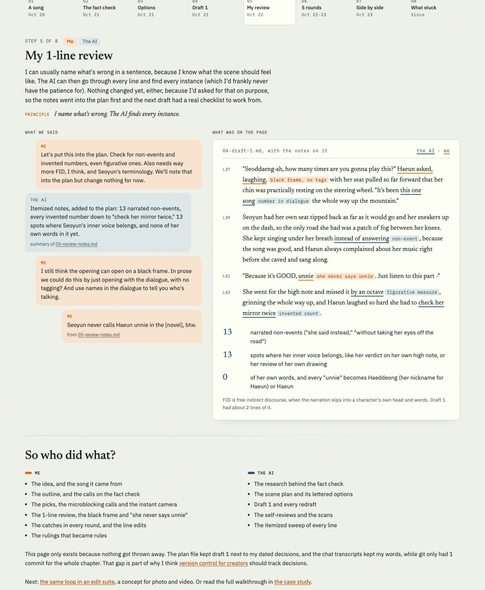
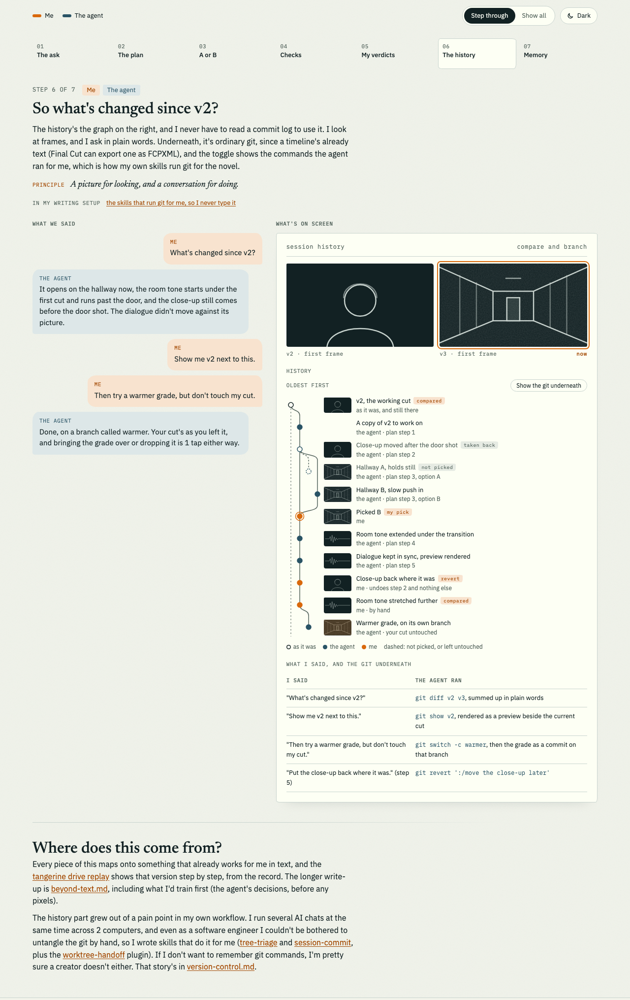

# CreatorLoop

[](https://github.com/cthleung/CreatorLoop/actions/workflows/test.yml)

CreatorLoop is the workflow I built for writing a novel with an AI, where I keep the taste and the machine does the legwork. The novel's a passion project that grew to about 400,000 words, far more than I could write by hand, so I built this to scale up my creativity without losing my vision. It's pulled straight out of my own writing setup, so everything in here came from real use (and, honestly, a lot of my own mistakes), and it's documentation first, so it's mostly about how the loop works and why, with 1 scene traced from the first idea to the published page.

<p>
  <a href="https://cthleung.github.io/CreatorLoop/demo/"></a>
  <a href="https://cthleung.github.io/CreatorLoop/demo/edit-suite.html"></a>
</p>

The [replay](https://cthleung.github.io/CreatorLoop/demo/) of 1 real scene (left), and the [edit-suite concept](https://cthleung.github.io/CreatorLoop/demo/edit-suite.html) for photo and video (right). Both open in your browser, no install needed.

## If you're hiring

If you're looking at this for an ML role on creative tools, here's the short version, and [for-reviewers.md](docs/for-reviewers.md) has the long one with links for every point:

- **Shipping tested code.** 3 years full time as a software engineer building AI tooling at a large bank, including deploying a PII-detection NER model on H100s and tuning it for 21 to 31 times lower latency at typical load. Plus the [tools](tools/) here, with 48 tests running on 3 operating systems.
- **LLMs on a real project.** Agents, evals, a self-hosted fine-tune, an on-device run with MLX and a plan for personal adapters, all built around a novel I'm actually writing.
- **Experimental design.** A [blind, repeated-run comparison](evals/results/2026-11-03-calibrated-vs-generic.md) of 2 reviewer briefs, with bootstrap intervals and McNemar - and an honest read of why the gold set's still too small to call it.
- **Product sense.** I [ditched a model that wrote better prose](docs/model-experiments.md), because a 2-minute cold start is the wrong experience for someone mid-scene.
- **Version control a creator can talk to.** I got tired of typing git for my novel, so I [built skills that do it for me](skills/README.md), and [version-control.md](docs/version-control.md) is how that'd work in a photo or video app.
- **Creative tools from the inside.** I'm a photographer and filmmaker, and [beyond-text.md](docs/beyond-text.md) is what I'd want from an agent in my own edit suite.

## The loop

```
my idea
  -> outline                      (mine)
  -> fact check                   (the AI researches, I make the calls)
  -> plan with lettered options   (the AI offers, I pick, combine or rewrite)
  -> draft + self-review + scan   (the AI)
  -> my review                    (usually short: I name what's wrong)
  -> revisions -> final           (the AI sweeps every line, I edit by hand)
  -> my rulings become rules and tests
  -> the next scene starts closer to what I want
```

The short version goes like this. I decide what a scene is about and how it should feel, which is the part I'd never really hand off, and the AI helps me check facts, lay out options, draft and sweep every line for problems. Every time I pick an option or overrule the AI, that choice gets written down somewhere it can read - a style rule or a test case, usually - so I don't have to make the same correction twice. Over time, the system ends up imprinted with my taste, and each new scene starts a little closer to what I want, which is probably the most useful thing it does for me.

## Start here

1. **[Why I built it](docs/why-i-built-it.md).** The story behind all this, from a kid in the 2000s imagining computers that make "fuzzy" decisions, to a novel that grew its own test suite.
2. **[The tangerine drive](case-study/tangerine-drive/README.md).** A single scene from the novel, start to finish, with every stage on record. My messages are in there too, so you can see what I actually said at each step and what the AI did with it. If you only read one thing, read this.
3. **[The replay](https://cthleung.github.io/CreatorLoop/demo/).** The same scene as a step-through, with my messages on one side and the page on the other, built only from the record. Next to it there's a [concept page](https://cthleung.github.io/CreatorLoop/demo/edit-suite.html) for how the loop would carry over into a video editor.

## What's in here

| Part | What it is | Status |
|---|---|---|
| [`case-study/tangerine-drive/`](case-study/tangerine-drive/) | The worked example: outline, fact check, plan, draft 1, review, 5 rounds of revisions, final | Done |
| [`docs/why-i-built-it.md`](docs/why-i-built-it.md) | The why | Done |
| [`docs/how-it-works.md`](docs/how-it-works.md) | The loop step by step, with the tool or agent behind each step | Done |
| [`docs/taste-memory.md`](docs/taste-memory.md) | How a pick or an override turns into a rule, a memory or a test | Done |
| [`docs/evaluation.md`](docs/evaluation.md) | Gold sets, blind tests, and why false alarms have to be zero | Done |
| [`docs/beyond-text.md`](docs/beyond-text.md) | The same loop for photo and video editing | Done |
| [`docs/version-control.md`](docs/version-control.md) | Version control you can see and talk to: where my commit skills came from, and how it'd work for other creators | Done |
| [`docs/the-harness.md`](docs/the-harness.md) | How it's built into VS Code and Claude Code: the hooks, skills, subagents, MCP servers, scripts and tests | Done |
| [`docs/for-reviewers.md`](docs/for-reviewers.md) | What creative-tools ML roles ask for, and where the evidence is | Done |
| [`evals/results/`](evals/results/) | Experiment write-ups, starting with the calibrated-vs-generic reviewer comparison | Done |
| [`docs/model-experiments.md`](docs/model-experiments.md) | Deploying my own fine-tuned model, why Claude won anyway, and where LoRA adapters come in | Done |
| [`tools/`](tools/), [`rules/`](rules/), [`evals/`](evals/), [`tests/`](tests/) | The scanner and its demo rule pack, the merge, the blind test and its demo gold set, the repeated-run stats, the preservation diff, the number picker and the tree triage behind the commit skills, all tested. Run `python3 -m unittest` | Done |
| [`skills/`](skills/) | The 2 skills that run git for me, tree-triage and session-commit, with the script behind them in `tools/` | Done |
| [`demo/`](demo/) | A clickable replay of the tangerine drive, and a concept page for the same loop in a video editor, [live here](https://cthleung.github.io/CreatorLoop/demo/) | Done |
| [`case-study/tangerine-drive/scan/`](case-study/tangerine-drive/scan/) | The tools' output on the case study, rerunnable | Done |
| [`agents/`](agents/) | The 5 cold reader prompts (voice, gloss, blocking, fact check, and the one that protects what already works), as Claude Code subagents | Done |

## A few notes

The novel itself stays private for now, but the case study scene is clean, and I've changed every name in it, so I'm pretty comfortable putting that one out in the open. The real-world details in that scene come from reference footage, and the case study says where.

Everything here runs on Claude through Claude Code today, though the loop itself doesn't really care which model sits in the middle (I tried swapping in my own, and wrote up how that went in [model-experiments.md](docs/model-experiments.md)). The cross-computer sync that keeps my unfinished work safe lives in its own repo, [worktree-handoff](https://github.com/cthleung/worktree-handoff).
